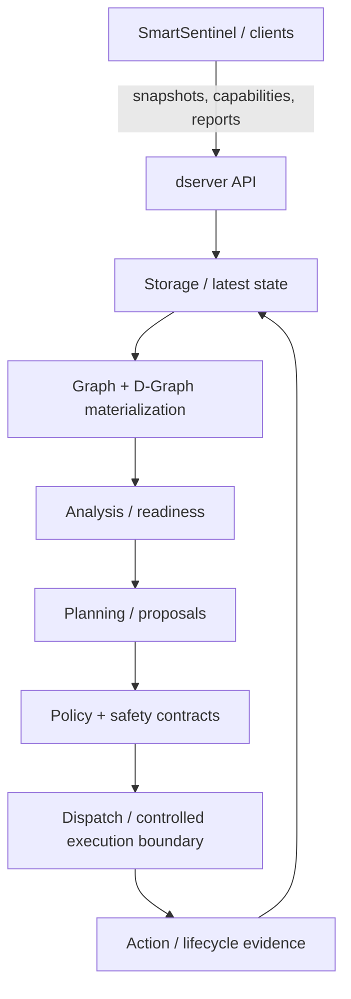

# dserver architecture

**dserver** is the central control-plane implementation of the current DATUM architecture.

It receives and stores distributed evidence, exposes control-plane APIs, materializes graph state, performs analysis/planning, and applies explicit contracts around controlled execution.

It is **not** DATUM itself. DATUM is the architecture/model; dserver is one implementation of central control-plane responsibilities.

## High-level responsibilities



The architecture deliberately keeps these stages distinguishable. A successful API request to store evidence is not the same as a successful plan; a plan is not dispatch; dispatch is not proof of execution.

## Server startup

`dserver/src/main.rs`:

1. loads `config.toml` into `AppConfig`;
2. initializes the Firebase storage client;
3. builds shared `AppState` with configuration and storage;
4. resolves the server bind address;
5. constructs the Axum router with the current API surface;
6. applies configured middleware such as CORS;
7. starts the HTTP control plane.

The bind address defaults to `0.0.0.0:8080` when `server.bind` is omitted.

## Configuration model

The current dserver config is defined in `dserver/src/config.rs`.

### `AppConfig`

| Field | Meaning / purpose |
|---|---|
| `server` | HTTP server behavior. |
| `firebase` | Firebase project/credential and collection-name configuration used by the current persistence implementation. |
| `cors` | Optional cross-origin policy for clients such as a dashboard/browser. |

### `ServerConfig`

| Field | Meaning | Why it exists |
|---|---|---|
| `bind` | Optional bind address, e.g. host/IP and port. | Allows lab/deployment environments to control network exposure. Omission falls back to `0.0.0.0:8080`. |
| `debug` | Optional debug flag. | Provides a configuration hook for debug behavior without encoding environment assumptions into the binary. Its exact effects should be documented wherever consumed. |

### `CorsConfig`

| Field | Meaning / purpose |
|---|---|
| `enabled` | Enables/disables configured CORS behavior. |
| `allow_any_origin` | Allows any origin when explicitly selected; broader than an allowlist and should be used deliberately. |
| `allowed_origins` | Explicit browser origins permitted when not using unrestricted origin policy. |
| `allowed_methods` | HTTP methods allowed by CORS policy. |
| `allowed_headers` | Request headers allowed by CORS policy. |

CORS is a browser access-control mechanism. It is not authentication or authorization for control-plane operations.

### `FirebaseConfig`

`project_id` and `credentials_path` are required in the current Rust model. The many `collection_*` fields are optional overrides for logical storage collections.

| Field | Purpose |
|---|---|
| `project_id` | Selects the Firebase project backing the current dserver persistence layer. |
| `credentials_path` | Points to credentials used to initialize the Firebase client. Sensitive credential contents must not be committed into documentation. |
| `collection_raw` | Override for raw/ingested snapshot storage. |
| `collection_latest` | Override for latest snapshot/state storage. |
| `collection_nodes` | Node-oriented storage collection. |
| `collection_graph_latest` | Latest graph materialization/storage. |
| `collection_analysis_latest` | Latest analysis output. |
| `collection_global_events_latest` | Latest global-event materialization. |
| `collection_project_topology` | Project topology configuration/state. |
| `collection_project_dmap` | Project DMap configuration/state. |
| `collection_action_plan_latest` | Latest action plan. |
| `collection_dispatch_latest` | Latest dispatch materialization. |
| `collection_node_capabilities` | Node capability documents. |
| `collection_action_results` / `collection_action_results_latest` | Historical/latest action-result evidence. |
| `collection_wasm_runtime_reports` / `..._latest` | Historical/latest WASM runtime reports. |
| `collection_wasm_module_registry` | WASM module descriptors/registry. |
| `collection_local_mapping_preflight_reports` / `..._latest` | Local mapping preflight evidence. |
| `collection_local_dgraph_snapshots` / `..._latest` | Local D-Graph snapshot evidence. |
| `collection_installation_tasks` | Materialized installation tasks. |
| `collection_installation_task_approvals` / `..._latest` | Approval evidence for installation tasks. |
| `collection_assisted_execution_requests` / `..._latest` | Assisted-execution request state. |
| `collection_assisted_execution_claims` / `..._latest` | Claim/ownership state for assisted execution. |
| `collection_assisted_execution_attempts` / `..._latest` | Execution-attempt history/latest state. |

These collection names belong to the current **persistence implementation**. They are not DATUM domain entities by themselves. Replacing Firebase would not require redefining DATUM concepts.

## Major control-plane domains

The current router exposes several families.

### Health and node evidence

- `/health`
- snapshots
- nodes/latest
- capabilities
- action results
- WASM runtime reports

These endpoints ingest or expose evidence about distributed participants.

### Graph / analysis / planning

- graph latest/materialized
- analysis latest/materialized
- topology
- DMap
- action-plan latest/materialized
- deployment planning
- installation plan/tasks

These endpoints transform stored information into higher-level control-plane state and proposals.

### D-Graph governed reasoning

The D-Graph API includes materialization, planner dry-run, readiness, artifact-integrity, capability-negotiation, execution-allowlist, resource-limit, rollback/audit, prerequisite, safety, policy, and operator-approval contracts.

The naming is intentional: these are separate contracts/gates rather than one boolean called `can_execute`.

### SmartSentinel lifecycle

The `/api/v1/sentinels` family represents registration and heartbeat/liveness of distributed SmartSentinel agents. Registration identity and heartbeat should not be confused with complete node telemetry or health.

### Controlled WASM

The `/api/v1/controlled-wasm` family preserves the previously validated controlled WASM deployment/lifecycle baseline, including source/observed D-Graph, deployment manifest, per-node deployment view, live reports, and deployment attempts/transitions/retry.

Historical guarantees of that phase must remain stable even as newer SmartSentinel observability/adaptation work evolves.

## Central truth vs. distributed evidence

SmartSentinel observes locally; dserver correlates globally.

This avoids a distributed agent declaring global IoTinuum truth from only its own perspective. dserver can compare multiple node reports, configured graph state, capability documents, action outcomes, and freshness before producing an observed/materialized control-plane view.

## Fail-closed design direction

Many current D-Graph contracts exist specifically so execution is not inferred from one positive signal. Technical capability, resource readiness, artifact integrity, policy, operator approval, and execution allowlists are distinct concerns.

A robust interpretation therefore looks like:

```text
capability present
+ evidence fresh
+ prerequisites satisfied
+ resource constraints satisfied
+ artifact integrity accepted
+ policy permits
+ approval/allowlist requirements satisfied
= operation may become eligible
```

Even then, eligibility is not proof that execution succeeded; outcome/lifecycle evidence closes that loop.
