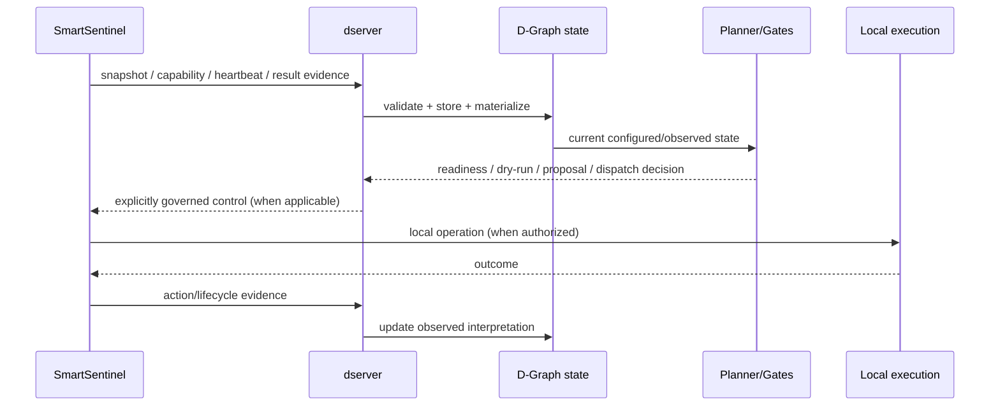

# Architecture overview

DATUM separates **model**, **observation**, **reasoning**, **control**, and **execution evidence**.

## Component roles

| Component / concept | Role |
|---|---|
| DATUM | Architecture and information model. |
| IoTinuum | Heterogeneous continuum environment in which distributed application roles execute. |
| D-Graph | Canonically the application graph (D-Serv vertices, D-Call edges, `datum.dgraph/1`). The structures currently called D-Graph in code are relabelled in the [glossary](../reference/glossary.md). |
| SmartSentinel | The distributed node agent. In canonical terms it currently implements **D-Agent** (observation, reporting, governed interaction — a project extension of the reference model, IoTMan Agent lineage) **plus the deployment executor**. |
| dserver | The **D-Controller** implementation: central control plane that receives evidence, materializes state, reasons, plans, and coordinates governed operations. |
| Runtime/executor mechanisms | Perform concrete local operations when authorization/contracts allow them. Phase 111/112 now provide governed D-Code execution and D-Call delivery; DNode hosting remains a separate runtime concern. |

## End-to-end information flow

## Observation is not control

Collectors and SmartSentinel can report that something changed without causing the change. dserver can update the observed graph without mutating the environment. This is the normal observation path.

## Reasoning is not execution

Analysis, readiness, planning, dry-run, proposals, and dispatch all represent progressively stronger control-plane decisions, but none should be presented as successful real-world mutation without execution/outcome evidence.

## Identity boundary

Logical `node_id` is the principal cross-component identity. Hostname, host ID, IP address, and physical/virtual machine identity are evidence/attributes that may change independently.

## Temporal boundary

DATUM data is time-sensitive. Timestamps, TTL, freshness thresholds, heartbeat sequence, and latest/history collections exist because a stored value can be valid evidence historically while no longer being safe to treat as current truth.

## Persistence boundary

The current dserver uses Firebase collections for persistence. Firebase is an implementation choice, not a defining DATUM concept. Domain semantics should remain stable if the persistence backend changes.

## D-Agent, executor, and D-Node (target separation)

The Stage 107 baseline defines a three-way separation that the current code does
not yet make explicit as modules. This is a **target**; current runtime behaviour
is unchanged.

| Responsibility | Canonical name | Current state |
|---|---|---|
| Node identity, resource-binding resolution, slice fetch, observation, evidence, heartbeat | **D-Agent** | Implemented inside SmartSentinel. A project extension of the reference model (IoTMan Agent lineage). |
| Gated host mutation: container lifecycle, secret resolution, runtime installation, and (future) `DNodeHost` lifecycle | **Deployment executor** | Implemented inside SmartSentinel, not a separate module. |
| Executing application D-Code as a service, and providing or supporting D-Serv communication per the selected communication model (direct / via the D-Node / hybrid) | **D-Node** | Phase 111 provides the governed D-Code execution substrate and Phase 112 provides one-edge D-Call delivery. Middleware transport and full DNode lifecycle remain later slices. |

The D-Serv **execution contract** (`DServExecutionContractV1`) is host-independent:
a D-Node hosted in a container and the same D-Node hosted as a native process must
produce identical execution contracts. Only the host-lifecycle projection (the
`dnode_runtime` workload) may differ. See
[ADR-0004](../adr/ADR-0004-dnode-runtime-agnostic-host.md).

## Historical phase boundaries

The codebase contains validated phase-specific behavior such as Controlled WASM Deployment and the newer SmartSentinel continuous observation loop. New phases must not silently rewrite the claims or safety properties of closed historical phases.

For example, the O1 SmartSentinel loop explicitly disables mutation even if older configuration contains desired-state or auto-recovery settings. That lets observation evolve independently from deployment automation.
