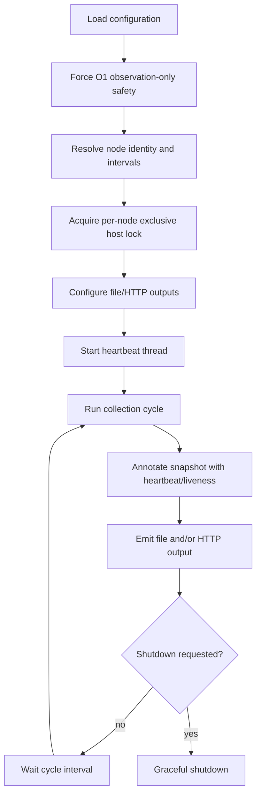

# SmartSentinel architecture

**SmartSentinel** is the distributed node agent in the current DATUM architecture. Its defining role is continuous observation and controlled interaction with one logical IoTinuum node; deployment is only one possible responsibility.

The current long-running implementation lives in `DATUM/src/agent/service_loop.rs` and the `smartsentinel` binary.

!!! note "SmartSentinel in canonical terms (Stage 107)"
    In the [DATUM canonical vocabulary](../reference/datum-canonical-model.md),
    SmartSentinel currently implements **two** responsibilities:

    - **D-Agent** — node identity, resource-binding resolution, slice fetch,
      observation, evidence, heartbeat. "D-Agent" is a **project extension**, not a
      DATUM-paper term; it continues the IoTMan Agent lineage of the
      IoTManA / IoTManS thesis.
    - the **deployment executor** — gated container lifecycle, secret resolution,
      runtime installation.

    A separate **D-Node** runtime, which actually executes application D-Code, does
    not exist yet. The target module split (D-Agent / executor / D-Node client) and
    the runtime-agnostic D-Node are introduced in later stages
    ([ADR-0004](../adr/ADR-0004-dnode-runtime-agnostic-host.md)). Stage 107 changes
    no SmartSentinel runtime behaviour.

## Service-loop lifecycle



## `ServiceLoopOptions`

```rust
pub struct ServiceLoopOptions {
    pub config_path: String,
    pub out_override: Option<String>,
    pub cycle_s_override: Option<u64>,
    pub heartbeat_s: u64,
    pub node_id_override: Option<String>,
    pub hostname_override: Option<String>,
    pub stop_file: PathBuf,
    pub max_cycles: Option<u64>,
}
```

| Field | Meaning | Why it exists |
|---|---|---|
| `config_path` | Path to the SmartSentinel/DATUM config file. | Lets the same binary run with host-specific configuration without recompilation. |
| `out_override` | Optional override for the file snapshot output path. | Useful in tests, parallel environments, and controlled runs without rewriting config. |
| `cycle_s_override` | Optional override of the configured collection interval. | Allows laboratory/service operation to tune cadence while preserving the stored configuration. Zero is rejected. |
| `heartbeat_s` | Heartbeat interval in seconds. | Separates lightweight agent liveness from the heavier collection cycle. Zero is rejected. |
| `node_id_override` | Optional override for logical DATUM node identity. | Supports explicit node-scoped runs/tests while retaining configuration as the normal source. Identity is used for the per-node singleton lock and downstream joins. |
| `hostname_override` | Optional host-name override. | Supports controlled validation and environments where detected/configured hostname needs to be replaced without changing logical `node_id`. |
| `stop_file` | File whose presence requests graceful agent shutdown. | Provides a cross-platform control mechanism that does not depend only on interactive Ctrl+C. |
| `max_cycles` | Optional finite collection-cycle limit. | Makes deterministic tests/acceptance runs possible while normal service mode remains continuous. `0` is rejected. |

## Why heartbeat and collection are separate

The heartbeat thread increments liveness independently of full data collection. This distinction matters:

```text
heartbeat present  -> the SmartSentinel process is alive
collection success -> the agent completed a collection cycle
telemetry content  -> evidence about host/runtime/service state
```

A heartbeat alone is not proof that every runtime or service is healthy.

## Node-scoped singleton protection

The agent creates an OS-backed exclusive lock in the host temporary directory using a sanitized `node_id`.

The purpose is not merely to prevent two processes in one working directory. It prevents a second checkout/clone from launching another SmartSentinel for the **same logical node** on the same host.

The lock file records `pid` and `node_id`, while the OS file lock provides the actual exclusion. The OS releases the lock on normal or abnormal process termination even if the small lock file remains.

## O1 observation-only boundary

The current continuous loop explicitly overrides mutation-oriented configuration at startup:

- auto-recovery is disabled;
- auto-recovery dry-run is forced;
- desired-state execution is disabled.

This is deliberate. The O1 service loop proves that SmartSentinel can operate as a persistent observer without silently executing remediation or deployment actions.

The startup log explicitly reports `mutations=disabled`, and collection logs report `side_effects=false`.

## Collection cycle

Each cycle:

1. increments a local collection sequence;
2. invokes `run_cycle_for_node_identity(...)` with the resolved logical node ID and optional hostname;
3. annotates the resulting snapshot with heartbeat/liveness data;
4. emits the snapshot to enabled outputs;
5. logs cycle identity, duration, uptime, heartbeat sequence, entity/edge/event/action counts, output status, and `side_effects=false`;
6. waits for the configured collection interval unless shutdown has been requested.

A collection error is logged but does not inherently mean the long-running process must terminate. This separates transient observation/output failures from agent lifecycle.

## Outputs

### File JSON

If enabled, the snapshot is written through `FileJsonOutput`. When no explicit file-output configuration is present, the current loop defaults to `snapshot.json`.

The file output is useful for:

- local debugging;
- reproducible evidence capture;
- offline inspection;
- tests that should not depend on dserver availability.

### HTTP JSON

When configured and enabled, `HttpJsonOutput` sends snapshots to the configured HTTP target with a project ID and timeout.

This is the path through which continuous SmartSentinel evidence can feed the central control plane.

Output failures are reported independently (`file_json=err(...)`, `http_json=err(...)`) so one output path does not erase visibility into the other.

## Shutdown paths

The current loop supports:

- `Ctrl+C`;
- stop-file request;
- reaching `max_cycles` in bounded runs.

The stop-file path is acknowledged during shutdown, the heartbeat thread is joined, and shutdown reason is recorded. These explicit paths make lifecycle behavior testable on Windows and Linux.

## Architectural rule

SmartSentinel is a **source of evidence and a controlled execution endpoint**, not the owner of global truth.

It observes one node. dserver correlates evidence across nodes and the D-Graph. This prevents one local agent from making unsupported global claims about the IoTinuum.
