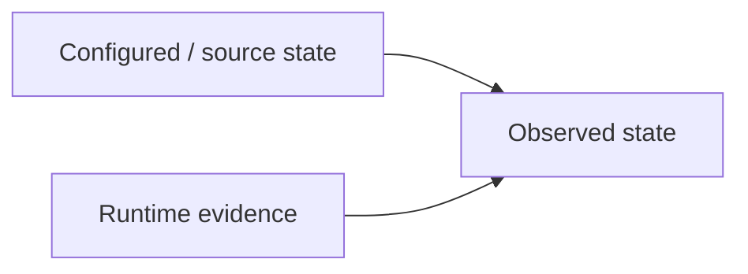
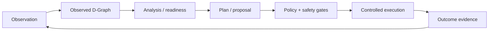

# DATUM

DATUM is an architectural framework and information model for representing, observing, reasoning about, and managing distributed applications across the computing continuum, referred to in this project as the **IoTinuum**.

DATUM provides a common representation for application components, computational resources, execution environments, capabilities, communication flows, runtime observations, and the relationships between them. Its central structural representation is the **D-Graph**.

## Why DATUM exists

Distributed IoT applications can span devices, edge/fog nodes, local infrastructure, cloud hosts, container runtimes, WebAssembly runtimes, processes, services, modules, and heterogeneous network paths. Those environments change while the application is running.

A static deployment description can tell us what is configured, but not necessarily what is true now. DATUM therefore separates four concerns:

1. **Configured / source information** — what the model says should exist or be related.
2. **Observed evidence** — what agents and runtime inspection report now.
3. **Reasoning** — readiness, analysis, planning, proposals, and policy decisions.
4. **Controlled execution** — explicitly governed actions that may mutate the real environment.

## DATUM is not an executor

DATUM itself is not a deployment engine and is not synonymous with either dserver or SmartSentinel.

- **D-Graph** is the structural information model.
- **dserver** is the current central control-plane implementation.
- **SmartSentinel** is the current distributed node agent.
- **Execution mechanisms** perform only actions that pass the relevant contracts and gates.

This distinction matters because a planner can produce a valid proposal without executing it, and the D-Graph can change because new evidence arrived without any mutation of the managed environment.

## Core concepts

### Node

A logical computational participant in the IoTinuum. A node can correspond to a VM, physical host, edge/fog machine, workstation, cloud host, or another execution participant. `node_id` is the stable DATUM identity; hostname and IP address are attributes, not substitutes for that identity.

### Runtime

An execution environment available on a node. The current capability model explicitly represents `container`, `wasm`, and `process` runtime families.

### Module

An application/executable component associated with a runtime, node, role, or flow. A module is not the same thing as the runtime that executes it.

### Flow

A logical application or data-flow relationship. A configured flow describes intended structure; it must not be confused with proof of the actual live data-plane path.

### Capability

A declared or observed ability. Capability and authorization are intentionally separate. For example, a container runtime may be available while `allow_execution` remains false.

### Observation / Evidence

An observation is something measured or inspected at a point in time. It becomes evidence when used to support a statement about system state. Evidence needs temporal context and provenance; old evidence can become stale.

## Configured state vs. observed state

DATUM never assumes that configured existence proves runtime health.

A configured runtime may be absent at runtime. A configured module may be stopped. A configured link may be unreachable. Conversely, the absence of evidence should be represented as **unknown**, not silently promoted to healthy.

## Reasoning and execution pipeline

Not every cycle reaches execution. Read-only observation, what-if planning, dry-run planning, readiness evaluation, and advisory proposals are valid end states.

## Current implementation boundary

In the current codebase, DATUM's local snapshot primitive is intentionally generic: a `Snapshot` contains metadata, entities, edges, events, and action records. Domain meaning such as node/runtime/module/flow is represented through entity kinds, attributes, relationships, and higher-level materialization rather than by one hard-coded Rust type for every domain concept.

The current SmartSentinel service loop runs continuously for a logical `node_id`, emits heartbeat/liveness information, executes collection cycles, and in the O1 baseline explicitly disables mutation-oriented desired-state/auto-recovery behavior. That is an architectural signal: **the agent is useful even when no deployment is happening**.

## Naming note

The expansion of the name **DATUM** is intentionally not frozen here yet because historical project material contains more than one expansion. Until one is selected and normalized across the project, DATUM is treated as the proper name of the architecture.
