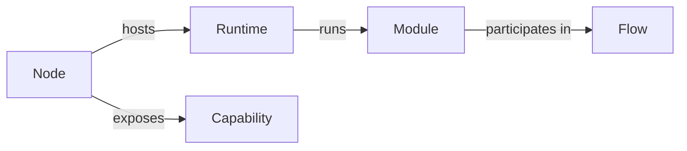
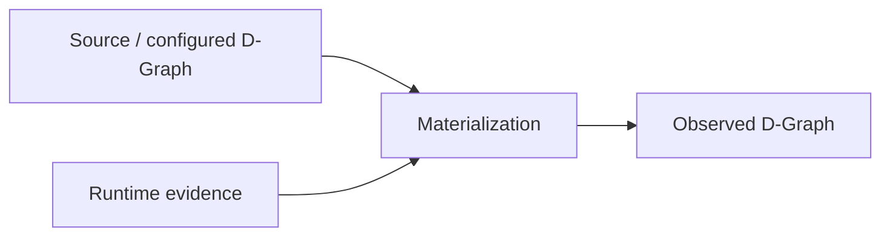

# D-Graph

!!! warning "Canonical D-Graph vs structures currently called D-Graph (Stage 107)"
    The [canonical application **D-Graph**](../reference/datum-canonical-model.md)
    is `G = (V, E)` with `V` = D-Serv and `E` = D-Call. It is **placement-free**,
    it may contain D-Call cycles, and it is expressed by the new `datum.dgraph/1`
    contract. It does **not** carry nodes, addresses, images or stages.

    The current codebase uses "D-Graph" for three other structures, each relabelled
    in documentation (no Rust type is renamed):

    - `OperationalDGraph` → **operational deployment document v1** (per-node desired
      container services, no edges);
    - `DGraph` → **controlled composite graph** (the closed C59–I44 phase:
      application + infrastructure + placement + health);
    - the snapshot-materialized graph → **observed runtime graph**.

    The rest of this page describes the current information-model structures and
    the observed-vs-source distinction, which remain valid. See the
    [Architecture Decision Records](../adr/README.md) for the canonical model.

## The legacy / composite information-model graph

Everything below this heading describes the **composite information-model graph**
that the current codebase (and this page's history) has called "D-Graph". It is
**not** the canonical application D-Graph of Stage 107; canonical `datum.dgraph/1`
is `G = (V, E)` with `V` = D-Serv, `E` = D-Call, and it carries no infrastructure,
runtimes, capabilities, flows or observed state.

The legacy / composite graph is DATUM's graph-based representation for
**correlating application structure with infrastructure, runtimes, modules,
capabilities, flows, and observed state** — that is, an operational correlation
model, distinct from the placement-free application graph.

It is an **information model**, not an executor.

## Why a graph

Distributed applications are fundamentally relational. A module runs in a runtime; a runtime is hosted by a node; a node exposes capabilities; modules participate in flows; observations change the interpretation of those relationships over time.

A graph preserves those relationships explicitly instead of flattening them into independent configuration sections.

Conceptually:



## Implementation primitives

The local DATUM `Snapshot` currently represents graph-like information with generic primitives:

- `Entity { id, kind, attrs, observed_at_utc, ttl_s }`
- `Edge { from, to, rel, attrs, observed_at_utc }`
- `Event`
- `ActionRecord`

This generic shape is intentional: the graph can evolve without requiring a dedicated Rust struct for every new domain entity.

### Why `kind` exists

`kind` assigns domain semantics to an otherwise generic entity. It allows an entity to represent a node, runtime, module, service, or another modeled resource while retaining a common storage/transport structure.

### Why `attrs` exists

`attrs` carries type-specific data that would not make sense on every entity. It lets DATUM add domain fields without inflating the common entity contract.

The trade-off is that field semantics must be documented and validated at the domain layer. `attrs` must not become an excuse for unstructured, undocumented state.

### Why relationships are typed

`Edge.rel` describes the meaning of a connection. Two entities being connected is insufficient; the control plane needs to know whether the relationship means hosting, execution, flow participation, connectivity, dependency, or another semantic relation.

## Source D-Graph and observed D-Graph

DATUM deliberately distinguishes graph information supplied/configured externally from graph state enriched with runtime evidence.



The source graph answers questions such as:

- what nodes and relationships are declared?
- where is a module intended to run?
- what flow is configured?

The observed graph answers questions such as:

- is the node currently healthy or stale?
- is the runtime actually available?
- what capabilities are currently supported?
- does recent evidence contradict the configured relationship?

## Materialization

**Materialization** is the process of combining available graph sources and evidence into a control-plane representation suitable for analysis.

Materialization must preserve provenance and uncertainty. Missing evidence should not be converted into a false healthy state.

## Time and freshness

DATUM graph state is temporal. Entities and observations carry timestamps, and the current local entity primitive also contains `ttl_s`.

`ttl_s` exists so that a previously observed entity can have an explicit validity horizon. The presence of stored data does not mean that the data is still current.

This supports distinctions such as:

```text
fresh     = evidence is recent enough for the current contract
stale     = evidence exists but is too old
unknown   = sufficient evidence is absent
unavailable = current evidence indicates the resource cannot be used
```

## Graph change is not real-world mutation

If new telemetry makes a node change from `healthy` to `unavailable` in the observed D-Graph, DATUM has changed its **representation** of the world; it has not caused the failure.

Likewise, changing a flow edge in graph metadata does not prove that real traffic was rerouted. A routing/adaptation claim requires data-plane or execution evidence showing that the actual target/path changed.

## How the D-Graph is used

The current dserver surface exposes D-Graph functions for:

- local D-Graph snapshots;
- materialized graph and summary;
- planner dry-run and summary;
- readiness summary;
- execution prerequisite/safety/policy contracts;
- artifact integrity;
- capability negotiation;
- execution allowlists;
- resource limits;
- operator approval;
- rollback/audit contracts.

This progression shows the intended role of the graph: it is the common state representation over which increasingly strict reasoning and controlled-execution boundaries operate.
