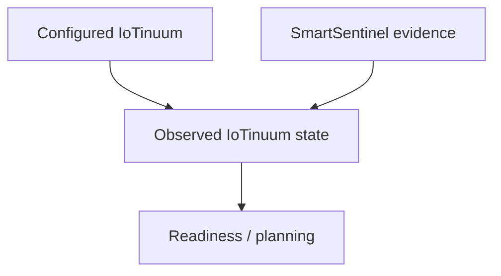

# IoTinuum

The **IoTinuum** is the heterogeneous computing environment across which a DATUM-managed distributed application operates.

It spans the continuum from devices and edge resources through fog/local infrastructure to cloud systems, but DATUM does **not** treat it as a rigid five-layer hierarchy.

## A continuum of roles, not fixed boxes

A deployment can contain stages such as:

```text
IoT device -> edge -> fog -> local -> cloud
```

These labels describe architectural roles or regions of the continuum. They do not imply one physical machine per stage.

For example:

- multiple fog nodes may implement the same fog stage;
- one physical host may expose more than one runtime role;
- a local workstation can participate as a control-plane host and also run application modules;
- a cloud VM may be functionally equivalent to another compute node for some flows while remaining topologically different.

## What DATUM models in the IoTinuum

DATUM correlates:

- logical node identity;
- stage/role;
- runtimes;
- application modules;
- capabilities;
- resource observations;
- health/freshness;
- network relationships;
- application flows;
- planned or active placement;
- evidence of execution outcomes.

This is why a node is more than an IP address and a stage is more than a deployment label.

## Configured topology and observed topology

The IoTinuum can have both a **configured** view and an **observed** view.

A configured relationship may say that `fog-01` participates in a flow. Runtime evidence may later show that the node is unreachable or that the required runtime is unavailable.



The architecture must preserve both meanings rather than overwrite configuration with observations.

## Node identity

DATUM uses logical node identity as the join key across snapshots, capabilities, SmartSentinel registration/heartbeat, action results, and dserver materialization.

`node_id` should remain stable even when:

- an IP address changes;
- a hostname differs between environments;
- a VM is recreated;
- the same software tree is cloned to another machine.

This prevents host-level evidence from being accidentally attributed to the wrong IoTinuum participant.

## Heterogeneity

Nodes can differ in:

- operating system;
- CPU architecture and capacity;
- memory and storage;
- container engine availability;
- WebAssembly runtime support;
- process execution capabilities;
- network reachability;
- application-specific services;
- policy and execution permissions.

DATUM therefore reasons from capabilities and evidence instead of assuming that every stage is interchangeable.

## Why the IoTinuum matters to placement and adaptation

A placement or failover decision is valid only if the candidate node satisfies the requirements of the workload and the current evidence is fresh enough to trust.

A candidate may be rejected because:

- the runtime exists in configuration but is unavailable now;
- the required capability is missing;
- execution is not authorized;
- resources are insufficient;
- connectivity is degraded;
- evidence is stale or unknown.

The IoTinuum is therefore the dynamic environment over which DATUM performs observation and reasoning—not simply a catalog of deployment targets.
