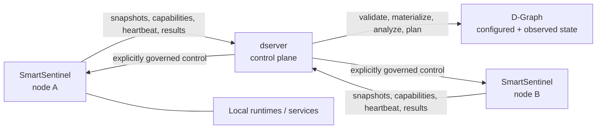

# DATUM Documentation

This site is the canonical documentation for the current DATUM architecture and implementation.

DATUM models distributed applications across the **IoTinuum** and provides the information and control boundaries used by components such as **dserver** and **SmartSentinel**.

The documentation is organized by meaning rather than by source-code directory:

- **Concepts** explain what DATUM, the IoTinuum, and the D-Graph mean.
- **Architecture** explains how the current components cooperate.
- **Data Models** documents structures and fields implemented in Rust.
- **API** maps the current dserver HTTP surface by domain.
- **Reference** freezes terminology used across the project.

!!! note "Canonical vs. historical documentation"
    The repository's `docs/` directory contains checkpoints, phase plans, validation evidence, handoffs, and historical engineering records. This MkDocs site is sourced from `documentation/` and describes how the system is understood **now**. Historical files remain evidence of how the architecture evolved and are not silently rewritten.

## Current high-level architecture

A central rule runs through the entire design: **observation, reasoning, authorization, and execution are separate stages**. A graph change, plan, or proposal is not proof that a real workload changed until execution and outcome evidence support that claim.
