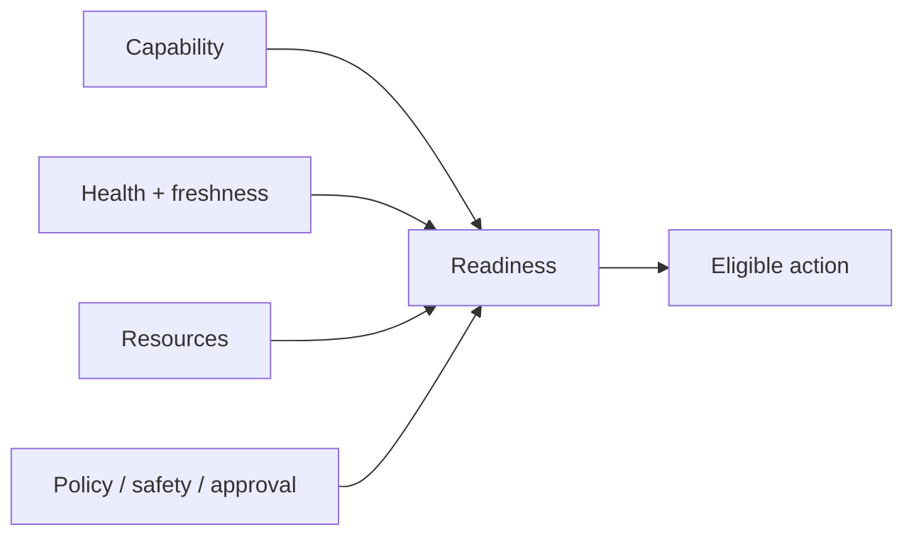

# Capabilities data model

The local capability model is defined in `DATUM/src/capabilities/model.rs`.

Capabilities answer **what a node/runtime can support**. They are intentionally separate from health, readiness, and authorization.

## `NodeCapabilities`

```rust
pub struct NodeCapabilities {
    pub project_id: Option<String>,
    pub node_id: Option<String>,
    pub stage: Option<String>,
    pub updated_at_utc: Option<String>,
    pub source: Option<String>,
    pub runtimes: RuntimeCapabilities,
    pub flow: Option<FlowCapabilities>,
    pub resources: Option<Value>,
    pub metadata: Option<Value>,
    pub extra: BTreeMap<String, Value>,
}
```

| Field | Meaning | Why it exists |
|---|---|---|
| `project_id` | Optional project/application scope. | Prevents capability data from being interpreted without the higher-level project context when multiple projects share infrastructure. |
| `node_id` | Optional logical DATUM node identity. | Correlates capabilities with snapshots, dserver node state, SmartSentinel, and graph materialization. |
| `stage` | Optional computational stage/role such as fog/local/cloud. | Helps reasoning understand the architectural role of the node without equating stage to physical identity. |
| `updated_at_utc` | Optional time at which the capability description was updated. | Supports provenance/freshness checks; capability knowledge can become stale as software/runtime state changes. |
| `source` | Optional producer/origin of the capability description. | Distinguishes configured, discovered, or agent-produced capability information. |
| `runtimes` | Structured runtime capability families. | Makes execution-environment support first-class instead of burying it in generic metadata. |
| `flow` | Optional flow-reconfiguration capabilities. | Separates data-path/control capabilities from execution-runtime capabilities. |
| `resources` | Optional resource-related capability/value document. | Extension point for resource information used by reasoning without freezing one resource schema at this layer. |
| `metadata` | Optional non-core metadata. | Carries auxiliary information that should not be promoted to a normative capability field. |
| `extra` | Flattened unknown/additional fields. | Provides forward compatibility: newer producers can add fields without older deserializers immediately failing. Important fields should graduate to typed fields when semantics stabilize. |

All top-level identity/time fields are optional in the Rust model. Consumers must therefore define when they are mandatory for a particular API/contract rather than assuming deserialization alone guarantees complete identity.

## `RuntimeCapabilities`

```rust
pub struct RuntimeCapabilities {
    pub container: Option<ContainerCapabilities>,
    pub wasm: Option<WasmCapabilities>,
    pub process: Option<ProcessCapabilities>,
    pub extra: BTreeMap<String, Value>,
}
```

| Field | Meaning / purpose |
|---|---|
| `container` | Describes container-runtime availability and supported container operations. `None` means no container capability document was supplied; it is different from `available=false`. |
| `wasm` | Describes WebAssembly runtime availability and supported WASM-related features. |
| `process` | Describes host/process execution-management capability. |
| `extra` | Forward-compatible extension fields for runtime families not yet promoted into the typed schema. |

The difference between **missing capability information** and **explicit unavailability** is significant:

```text
container = null                  -> capability information not supplied
container.available = false       -> producer explicitly reports unavailable
container.available = true        -> runtime reported available
```

## `ContainerCapabilities`

| Field | Meaning | Why it exists |
|---|---|---|
| `available` | Whether the container execution environment is currently/declared available. | Fundamental eligibility gate; unsupported runtime operations should not be planned against an unavailable engine. |
| `engine` | Optional engine identifier/name. | Captures runtime implementation differences without hard-coding one engine. |
| `allow_execution` | Optional policy/permission signal for execution. | Separates technical availability from permission to mutate the environment. `available=true` must not imply execution is authorized. |
| `supports_existing_start` | Whether an existing stopped container can be started. | Allows planners to distinguish start-existing from create/pull workflows. |
| `supports_restart` | Whether restart is supported. | Enables capability-aware remediation/lifecycle planning. |
| `supports_create` | Whether new container creation is supported. | Prevents plans from assuming the agent can create resources merely because an engine exists. |
| `supports_pull` | Whether image pull is supported. | Distinguishes local-only execution from workflows that can fetch missing images. |
| `extra` | Forward-compatible extension fields. | Preserves schema evolution. |

## `WasmCapabilities`

| Field | Meaning | Why it exists |
|---|---|---|
| `available` | Whether a WASM runtime is reported available. | Basic eligibility for WASM placement/execution. |
| `runtime` | Optional runtime implementation/name. | Records which WASM environment backs the capability. |
| `allow_execution` | Optional execution permission. | Keeps runtime detection separate from governed execution permission. |
| `supports_wasi` | Whether WASI support is available. | Workloads requiring WASI should not be assigned to runtimes lacking it. |
| `supports_http` | Whether the runtime environment supports the project's HTTP-related WASM capability. | Allows protocol/interface requirements to participate in eligibility reasoning. |
| `supports_mqtt` | Whether the runtime environment supports the project's MQTT-related WASM capability. | Allows MQTT-dependent modules/flows to be gated explicitly. |
| `extra` | Forward-compatible extension fields. | Allows evolution without rejecting unknown fields. |

## `ProcessCapabilities`

| Field | Meaning | Why it exists |
|---|---|---|
| `available` | Whether host/process-level management is available. | Indicates whether process-oriented actions can even be considered. |
| `allow_execution` | Optional permission for process execution/mutation. | Separates host capability from authorization. |
| `supports_restart_command` | Whether restart-command style remediation is supported. | Enables planners to avoid proposing unsupported restart operations. |
| `extra` | Forward-compatible extension fields. | Schema evolution. |

## `FlowCapabilities`

`FlowCapabilities` describes what types of **flow reconfiguration** a node/agent can support.

| Field | Meaning / purpose |
|---|---|
| `supports_mqtt_reconfigure` | Indicates support for MQTT-oriented flow reconfiguration. |
| `supports_http_reconfigure` | Indicates support for HTTP-oriented flow reconfiguration. |
| `supports_bridge_reconfigure` | Indicates support for bridge reconfiguration. |
| `supports_proxy_reconfigure` | Indicates support for proxy reconfiguration. |
| `extra` | Forward-compatible extension fields. |

These fields are optional because `false` and `unknown/not supplied` are different states. A planner should not silently interpret an omitted field as positive support.

## Capability is not readiness

A node can report a capability and still be ineligible for a specific action because:

- evidence is stale;
- node/runtime health is degraded;
- resources are insufficient;
- policy denies the operation;
- operator approval is missing;
- artifact integrity/prerequisites fail;
- execution is not allowed.

Conceptually:



## Capability is not authorization

The most important semantic rule in this model is:

```text
available != allow_execution
```

`available` answers a technical/environmental question. `allow_execution` participates in a control/policy question. Keeping them separate is part of DATUM's fail-closed execution design.
