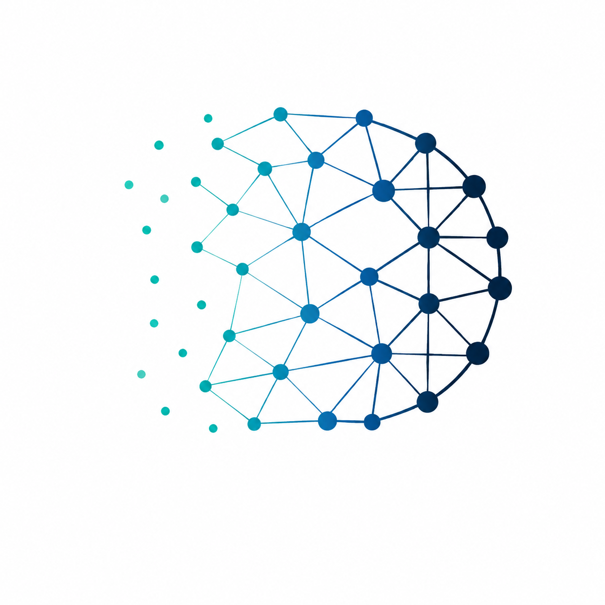
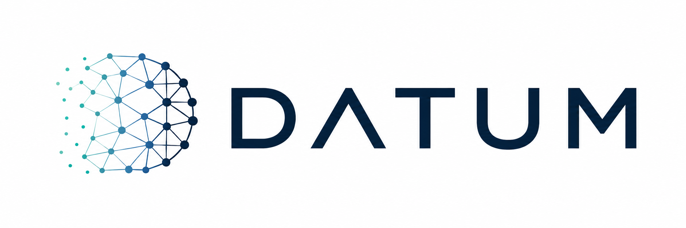
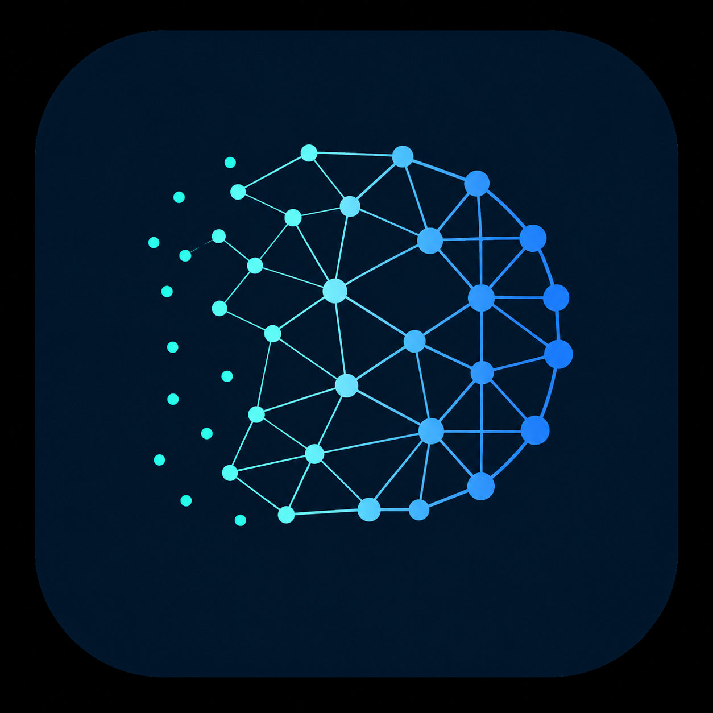

# Visual Identity

The DATUM visual identity represents the architecture as a **distributed graph spanning the computing continuum**.

{ width="520" }

## Concept

The symbol forms a stylized **D** from interconnected nodes and edges. It reflects three ideas that are central to DATUM:

- the **D-Graph** as the common relational representation;
- distributed state and observation across multiple computational nodes;
- progression across the **IoTinuum**, from sparse device-side state toward denser edge, fog, and cloud environments.

The increasing graph density is intentionally suggestive rather than literal. The IoTinuum is not defined as a rigid linear hierarchy, and DATUM does not require information or workloads to move through fixed device -> edge -> fog -> cloud stages.

## Primary logo

{ width="900" }

The horizontal logo combines the graph-based symbol with the DATUM wordmark. It is the preferred form for documentation landing pages, repository presentation, slides, posters, and other contexts where the project name should be immediately visible.

## Monochrome mark

The monochrome white mark is intended for dark or strongly colored backgrounds, including the MkDocs header.

  

## Application icon

{ width="260" }

The application icon is a compact presentation of the same graph concept and is suitable for favicon, application launchers, repository avatars, and other square-format uses.

## Visual semantics

The identity should remain consistent with DATUM's architectural language:

| Visual element | Architectural meaning |
| --- | --- |
| Node | An identifiable participant or modeled entity |
| Connection | A relationship or flow between modeled entities |
| Sparse graph | Local or less aggregated computational context |
| Dense graph | Increasingly interconnected computational context |
| D shape | DATUM and the D-Graph as the common information model |

The symbol must not be interpreted as a neural network topology, a centralized cloud, or a security shield. Its intended meaning is a **distributed relational system across the IoTinuum**.

## Asset files

The current identity assets are maintained under `documentation/assets/brand/`:

- `datum-logo-horizontal.png` — primary horizontal logo;
- `datum-symbol.png` — standalone graph symbol;
- `datum-monochrome.png` — white monochrome mark for dark backgrounds;
- `datum-icon.png` — compact square application icon.

These assets are currently the canonical visual baseline for the documentation. Future vector/SVG versions may replace the raster files while preserving the same visual concept.
